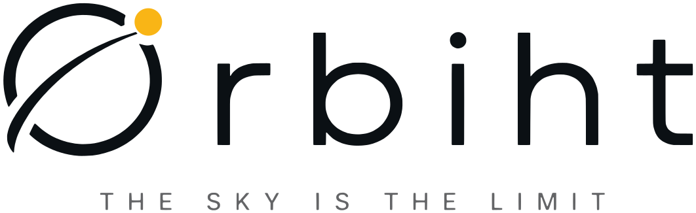

  <a href="https://orbiht.com">
    <picture>
      <source media="(prefers-color-scheme: dark)" srcset="./orbiht-lockup-light.svg">
      
    </picture>
  </a>

  <b>Software, AI and automation for teams that want to move faster.</b> 
  Web, mobile and desktop apps · custom AI systems · workflow automation

  <a href="https://orbiht.com">orbiht.com</a> ·
  <a href="https://studio.orbiht.com">Dandara Studio</a> ·
  <a href="https://orbiht.com/blog">Blog</a> ·
  <a href="https://orbiht.com/research">Research</a> ·
  <a href="mailto:hello@orbiht.com">hello@orbiht.com</a>

---

## What we build

| | |
|---|---|
| **Web** | SaaS platforms, dashboards, e-commerce and marketing sites on a modern stack |
| **Mobile** | iOS and Android apps from one codebase, shipped to both stores |
| **Desktop** | Cross-platform apps for Windows, macOS and Linux, with auto-updates |
| **AI systems** | Assistants, agents and copilots built around your data and workflows |
| **Automation** | End-to-end automation of the repetitive work across your tools and teams |
| **Data & cloud** | Pipelines, BI dashboards, CI/CD and infrastructure that stays fast and online |

## Our product: Dandara Studio

**Describe it. Dandara does the rest.**

[Dandara Studio](https://studio.orbiht.com) keeps your social media alive without design, video or marketing skills.
Tell Dandara what you need in your own words and she creates posts, carousels, stories and short videos in your
brand, schedules them on Instagram, Facebook, LinkedIn and YouTube, and helps you reply to your customers,
in any language.

A desktop app for Windows, macOS and Linux. The first 1,000 users get everything in Studio Solo, free.

## How we work

1. **Discovery** — we map your goals, users and operations.
2. **Design & build** — short sprints, working software every week.
3. **Launch & integrate** — on the web, the app stores or your team's machines, connected to the systems you already use.
4. **Evolve** — we monitor, refine and extend it as your business grows.

## Stack

---

<b>🇵🇹 Em português</b>

 

**Software, IA e automação para equipas que querem avançar mais depressa.**

Criamos apps web, móveis e desktop, sistemas de IA à medida e automação de processos, para startups e empresas
em crescimento. Também fazemos o nosso próprio produto, o [Dandara Studio](https://studio.orbiht.com/pt/):
descreves o que queres e a Dandara cria posts, carrosséis e vídeos na tua marca, agenda-os nas tuas redes e ajuda-te
a responder aos clientes, em qualquer idioma. Os primeiros 1.000 utilizadores têm o plano Studio Solo completo, grátis.

[orbiht.com/pt](https://orbiht.com/pt) · [hello@orbiht.com](mailto:hello@orbiht.com)

The sky is the limit.

